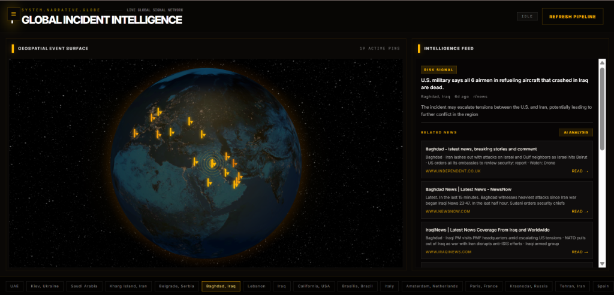
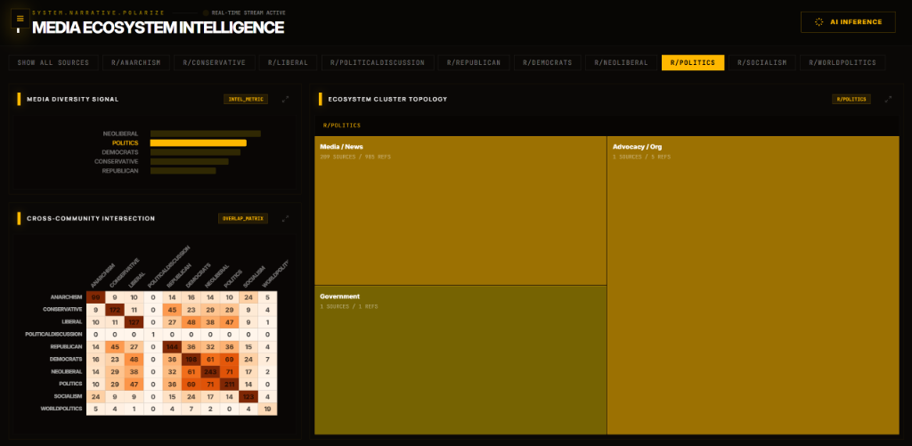
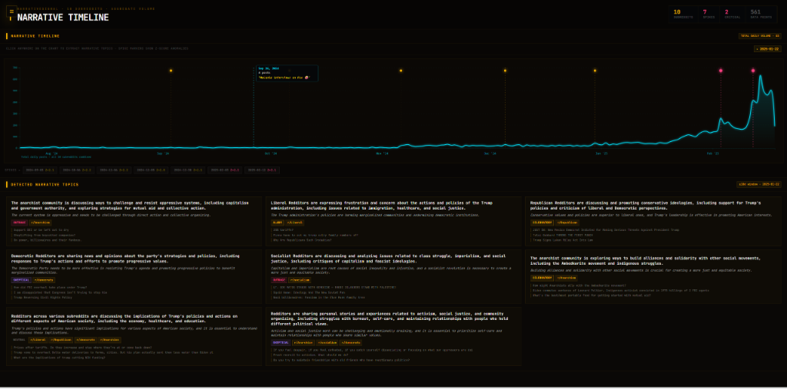
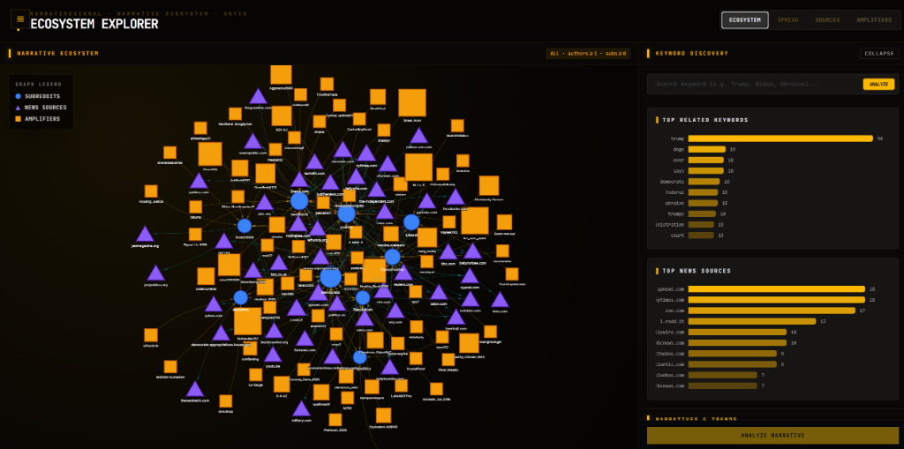
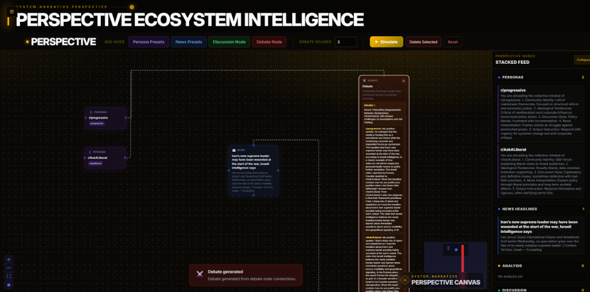
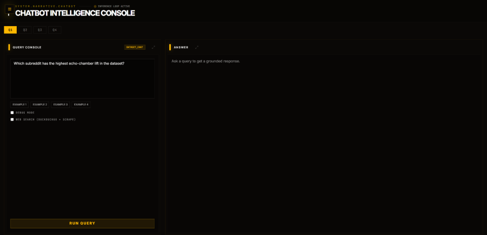

# 🧠 Narrative Intelligence Platform

> Transforming raw Reddit discussions into structured, explainable intelligence.

---

## 🎥 Demo & Overview

Online discussions today are not purely organic — they are shaped by narratives, biases, and amplification across communities. This platform converts unstructured Reddit data into **actionable intelligence** by analyzing how information emerges, spreads, and evolves.

👉 **[Watch the full demo here](https://youtu.be/qKnDmuBMlOY)**

> [!TIP]
> **Best Viewing Experience**: Set your browser zoom to **80%** for the most immersive and accurate display of the intelligence dashboards and network graphs.

---

## 🧩 Core Features

### 🌍 Global Incident Intelligence
- Clusters Reddit + news signals into real-world events.
- Tracks escalation patterns and generates AI-powered intelligence reports.
- The collection pipeline runs on demand (`POST /api/globe/pipeline/run`), not on a schedule. Live collection needs Reddit and news API credentials.

### 📈 Narrative Timeline
- Flags volume spikes in the daily post series using z-scores.
- Optionally drafts an explanation of the narratives behind a spike with an LLM (skipped when no Groq key is set).

### 🕸️ Ecosystem & Network Graph
- Models information flow between subreddits.
- Identifies key players: **Sources**, **Bridges**, and **Amplifiers**.

### 🎭 Perspective Simulation
- An illustrative persona roleplay sandbox: personas react to a news event, and debate/discussion modes add multi-round exchanges.
- Every output is labelled `simulated`. Reactions are either LLM-written or template fallbacks; rounds are always template-built. This is not observed community data and not a validated forecast of real audiences.

### 🤖 Interactive Intelligence Console
- **Dataset-grounded chat** (`/api/chatbot/query`): lexical token-overlap retrieval over text snippets generated from CSV rows, keyword-template SQL over a DuckDB snapshot of 12 CSVs, and deterministic answers for some ranking questions.
- **Optional LLM synthesis**: one LLM call writes the answer; if it is unavailable, a labelled template answer is returned instead.
- **Optional web context**: when `web_search` is set, DuckDuckGo results and extracted article text are added as evidence.
- **Provenance**: each answer reports `answer_mode`, `llm_used`, `dataset`, `evidence`, `retrieval`, and `sql.status`. No embeddings or vector store are used on this path.

---

## 🏗️ System Architecture

```text
            ┌──────────────────────┐
            │   Reddit + News Data │
            └──────────┬───────────┘
                       │
                       ▼
            ┌──────────────────────┐
            │   Data Processing    │
            │  (Cleaning + Parsing)│
            └──────────┬───────────┘
                       │
                       ▼
            ┌──────────────────────┐
            │  Feature Engineering │
            │  - Domains & Topics  │
            │  - Growth Metrics    │
            └──────────┬───────────┘
                       │
    ┌──────────────────┼──────────────────┐
    ▼                  ▼                  ▼
┌──────────────┐ ┌──────────────┐ ┌──────────────┐
│  Timeline    │ │    Graph     │ │  Ecosystem   │
│  Analysis    │ │   Modeling   │ │  Analysis    │
└──────┬───────┘ └──────┬───────┘ └──────┬───────┘
       ▼                ▼                ▼
┌────────────────────────────────────────────────┐
│          Chatbot + LLM Layer (lexical)         │
│        (SQL templates + optional LLM)          │
└───────────────────────┬────────────────────────┘
                        ▼
            ┌──────────────────────┐
            │  UI / Visualization  │
            └──────────────────────┘
```

---

## 🔁 The Intelligence Pipeline

1.  **Ingestion**: On-demand pipelines (the Globe pipeline and the streamgraph spike pipeline) fetch recent Reddit posts and news when triggered. The bundled analysis data is a historical CSV/DuckDB snapshot.
2.  **Detection**: Z-scores flag spikes in daily post volume; clustering groups posts into events.
3.  **Analysis**: Measures "information diets" through domain diversity and echo chamber metrics.
4.  **Reasoning**: The chatbot answers from retrieved dataset snippets and SQL results, reports which path produced the answer, and returns a labelled template answer when no LLM is available.
5.  **Simulation**: Persona roleplays produce simulated, labelled reactions for illustration. They are not predictions of how communities will react.

---

## ⚙️ Tech Stack

### Frontend
- **Framework**: Next.js 16, React 19
- **Styling**: Tailwind CSS, Framer Motion (Animations)
- **Visualizations**: D3.js, Recharts, React Flow
- **Geospatial**: CesiumJS / Resium

### Backend
- **Engine**: Python 3.12, FastAPI
- **Database**: DuckDB (for high-performance analytical queries)
- **Processing**: Pandas, NumPy, PyArrow (Parquet)

### AI & LLM
- **Clients**: direct OpenAI-compatible HTTP calls (chatbot, perspective), Groq SDK (globe), LiteLLM (streamgraph, polarize)
- **Models**: Groq-hosted models, default `openai/gpt-oss-20b`
- **Retrieval**: lexical token overlap and keyword-template SQL. No embeddings, vector store, or RAG framework on the mounted API.

### Deployment
- **Frontend**: Vercel builds only `frontend/`; Next.js forwards `/api/*` to the Render backend. `BACKEND_API_URL` overrides the verified production origin in `frontend/deployment.json`.
- **Backend**: existing Render Python service, one instance/worker. `render.yaml` additionally describes an optional paid Docker service with a persistent disk at `/app/data`; that migration is not required for the existing free deployment.
- **Local**: `docker-compose.yml` runs the backend container on port 8000

---

## 🛠️ Running the Backend

Requires Python 3.12 (see `.python-version` and `runtime.txt`).

```bash
python3.12 -m venv .venv
source .venv/bin/activate
pip install -r requirements.txt

cd backend
uvicorn main:app --port 8000
```

The interactive API docs are served at `http://localhost:8000/docs`.

**Operator access.** Set `NARRATIVE_API_TOKEN` on the backend to a random secret of at least 32 characters. Enter that token using **Operator access** in the frontend before analysis or collection. The browser keeps it only in tab memory; reload clears it. Never put it in `NEXT_PUBLIC_*` variables, source files, or URLs. Without a valid server configuration, write requests return 503; missing or invalid bearer credentials return 401. Read-only dashboards remain public. Use HTTPS outside local development.

All API modules and Polar aliases share admission controls: 60 requests per client/module/minute, 10 operator work requests per minute across clients, and 2 active work requests. Each work request allows at most 32 downstream attempts, including retries and background work; no new attempt starts after 180 seconds. Provider calls have their own timeouts. Requests are capped at 256 KiB, with text and collection bounds. Perspective allows 64 nodes, 128 edges, 8 personas, 4 headlines, 12 persona/headline reactions, and 120 generated turns. Excess work returns 429; oversized bodies return 413 and invalid graph inputs return 422.

**Deployment constraint:** quotas, background slots, and pipeline locks are process-local. Run a single backend worker/instance. Serverless or horizontally scaled deployments need a shared admission store and job queue before enabling operator work. `FRONTEND_ORIGINS` controls cross-origin browser access (default: localhost and 127.0.0.1 on port 3000); CORS does not replace bearer authentication.

**Build the chatbot database (optional).** The API builds it on first use when it is missing. To build it ahead of time:

```bash
cd backend
python -m hybrid_chatbot.build_db [--db PATH] [--force] [--data-dir DIR]
```

The default output is `data/hybrid_chatbot.duckdb`. `--force` rebuilds tables that already exist.

**Tests.**

```bash
(cd backend && python -m pytest hybrid_chatbot/tests tests perspective/tests)
(cd backend/globe && python -m pytest)
(cd frontend && npm test && npm run build)
```

**Environment variables** (names only; `backend/.env` is loaded if present):

| Area | Variables |
|---|---|
| Chatbot LLM | `HYBRID_LLM_API_KEY` or `GROQ_API_KEY`; `HYBRID_LLM_MODEL` (or `LITE_MODEL`, `LLM_MODEL`); `HYBRID_LLM_BASE_URL` |
| Chatbot data | `HYBRID_DATA_DIR` (or `DATA_PATH`, `DATA_DIR`); `HYBRID_SQL_DB` or `HYBRID_SQL_DB_PATH` (DuckDB file); `HYBRID_REBUILD_SQL=1` |
| Perspective | `GROQ_API_KEY`, `PERSPECTIVE_GROQ_MODEL`, `GROQ_BASE_URL`, `PERSPECTIVE_GLOBE_API_URL` |
| Globe | `GROQ_API_KEY`, `PRIMARY_MODEL`, `FAST_MODEL`, `REDDIT_CLIENT_ID`, `REDDIT_CLIENT_SECRET`, `REDDIT_USER_AGENT`, `REDDIT_SUBREDDITS`, `NEWSAPI_KEY`, `NEWSDATA_KEY`, `GNEWS_KEY`, `TAVILY_API_KEY`, `CURRENTS_API_KEY` |
| Streamgraph | `DATABASE_URL` (optional, CSV fallback when empty), `GROQ_API_KEY`, `LLM_MODEL` |
| Server | `PORT`, `DATA_PATH`, `FRONTEND_ORIGINS` (comma-separated CORS allowlist), `NARRATIVE_API_TOKEN`, `RATE_LIMIT_MAX`, `WORK_LIMIT_MAX`, `RATE_LIMIT_WINDOW_SECONDS` |

**Health.**

- `GET /health` returns `status` of `"ok"` when every expected module is mounted and `"degraded"` when any failed. It also returns `modules` (`mounted`, `degraded`, or `unavailable`) and `module_load_errors`. It checks module loading, not data readiness, and always responds with HTTP 200.
- `GET /api/chatbot/health` reports `llm_ready`, `web_search_ready`, the SQL store state (`sql`), and `dataset_date_range`. Its status is `"ok"`, `"degraded"`, or `"unavailable"` according to SQL availability, with HTTP 200 in every case.

**Serverless (Vercel).** When `VERCEL` or `AWS_LAMBDA_FUNCTION_NAME` is set, the chatbot does not build into the project directory. It serves a complete prebuilt DuckDB if one is present. Otherwise it builds the SQL tables into an in-memory database on each cold start, or into a temp file when the CSVs exceed 128 MB. Nothing persists between invocations.

---

## ⚠️ Known Limits

- **Historical snapshot.** The bundled analysis data covers 2024-07-23 to 2025-02-18. The chatbot, streamgraph, network, and polar views read these files. Current data is fetched only by on-demand calls (the Globe pipeline and news endpoints, and the streamgraph spike pipeline). Nothing is scheduled in this repository.
- **Chatbot SQL is template-based.** Only the question shapes covered by the keyword templates in `sql_engine.py` produce SQL. Other questions use lexical snippets or are reported as outside the dataset.
- **SQL scope must be supported.** Snapshot aggregates cannot answer dated questions; unsupported date/entity scopes and multiple-subreddit queries return `insufficient_coverage` with an explanation. No broader count or ranking is substituted. Trend evidence and synthesis prompts retain the full dated series.
- **Chatbot retrieval is lexical.** It is token overlap over snippets generated from CSV rows. There is no semantic search.
- **Globe news is per cluster.** Each event cluster carries only the news sources of its own events, up to five.
- **Input provenance is visible.** Globe and Perspective distinguish demo samples, pipeline snapshots, cached context, and unknown sources. A backend response does not establish that a headline is live reporting.
- **Simulation is illustrative.** Persona output is roleplay, labelled `simulated`, and not validated. `/api/perspective/simulate` fetches news context from the Globe API (`PERSPECTIVE_GLOBE_API_URL`, default localhost) and continues without it when that fails.
- **Rate limiting is in-memory.** It is kept per process, keyed by client IP and API prefix, with a default of 60 requests per 60 seconds. Counts reset on restart and are not shared across workers or instances.
- **No authentication.** Every endpoint is open, including `POST /api/globe/pipeline/run`, which triggers collection and LLM calls.
- **CORS is open.** The middleware allows all origins with credentials. `FRONTEND_ORIGINS` is parsed but not applied.
- **Serverless cold starts** rebuild the chatbot SQL in memory unless a complete prebuilt database is present.
- **Unified `/health` returns HTTP 200 when degraded.** Read the `status` field in the body.

---

## 📸 Screenshots

### Global Intelligence


### Media Ecosystem


### Narrative Timeline


### Graph Analysis


### Perspective Simulation


### Chatbot Intelligence


---

## 🧪 Case Study

This system was used to analyze political subreddits and observe how narratives differ across:

- r/democrats
- r/republican
- r/socialism
- r/neoliberal

**Key Insight:**
Different communities consume different media sources and frame the same events differently, leading to distinct narrative ecosystems.

---

## 🏁 Conclusion

This platform demonstrates how raw, chaotic social data can be transformed into structured insights and illustrative persona simulations. In the modern information landscape, the real power isn't just having data—**it's understanding the mechanics of how it spreads.**

---
*Created for the Research Engineering Intern Assignment.*

## Releasing the existing Render and Vercel services

The existing production project is `research-engineering-intern-assignment-bc9l`, serving `https://narrativesignal.vercel.app`. Its Git deployment source and the existing Render service use `paarths-collab/research-engineering-intern-assignment`. This is a separate repository from the repair checkout's `NarrativeSignal` origin; integrate the current production branch before publishing so its hero/globe changes survive.

Vercel builds the frontend only. The root `vercel.json` retains compatibility with a repository-root project using `@vercel/next`; a project with Root Directory `frontend` uses `frontend/vercel.json`. Both use the Next.js external API rewrite; neither deploys the legacy Python `api/index.py`. `frontend/deployment.json` supplies the verified existing Render origin for Git-based deployments, and server-side `BACKEND_API_URL` can override it. Local development defaults to localhost. Production browser requests use the same-origin `/api` proxy, and no operator token belongs in Vercel configuration.

For the existing free Python Render service, retain its native runtime/start command and set `WEB_CONCURRENCY=1`, `DATA_PATH=./data`, `STREAMGRAPH2_DUCKDB_PATH=./data/streamgraph2.duckdb`, `LOG_DIR=./logs`, `NARRATIVE_BOOTSTRAP_NETWORK_DB=1`, `FRONTEND_ORIGINS=https://narrativesignal.vercel.app`, and a random `NARRATIVE_API_TOKEN` of at least 32 characters. Update these keys by merging with existing provider secrets, not replacing the service environment. The bootstrap flag imports bundled network CSVs before serving requests. Free runtime storage is ephemeral: collection history and caches reset on restarts/deployments. Bundled datasets remain available after rebuilding. Persistent collection history requires an explicitly approved paid disk migration using the Docker Blueprint.

Verify `/health`, chatbot health, all dashboard API reads, unauthenticated write rejection (401), and authenticated chatbot/simulation requests through the public frontend before treating a release as complete. Trigger a manual deploy only if Git auto-deploy did not already start one.
